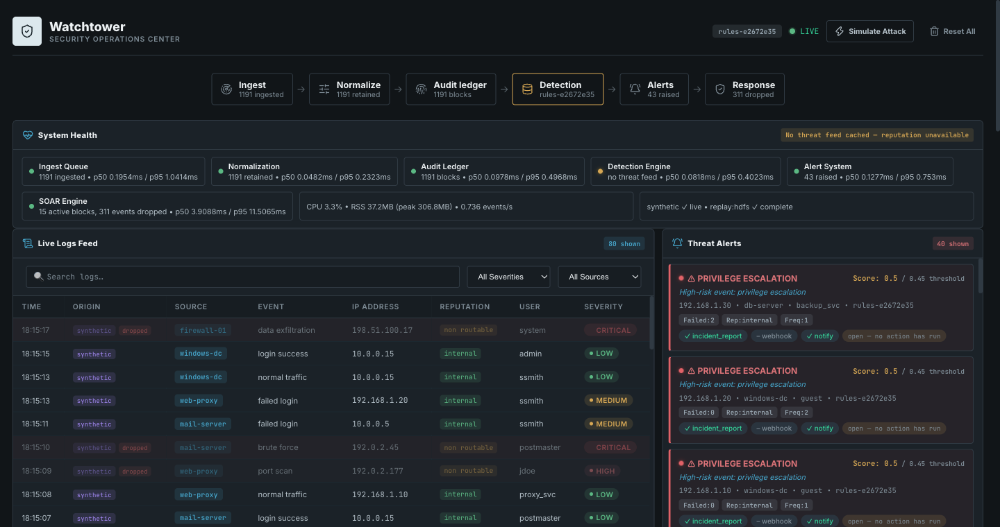
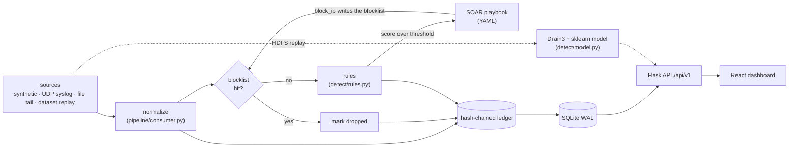
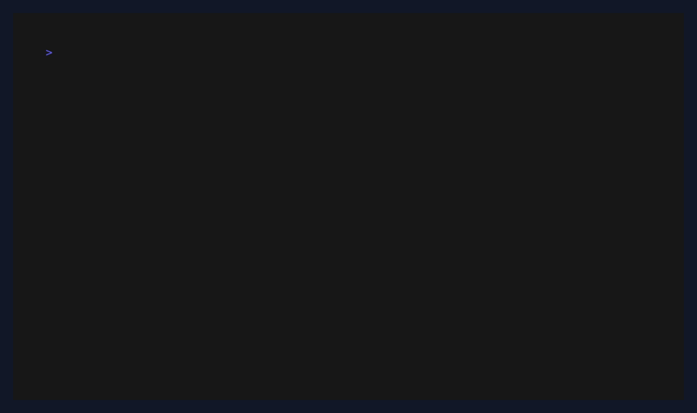

# Watchtower

[](https://github.com/Shlok014/watchtower/actions/workflows/ci.yml)
[](LICENSE)
[](backend/requirements.txt)
[](frontend/package.json)

A small security-operations (SOC) pipeline: it ingests logs from four sources, scores them with
deterministic correlation rules, responds through YAML playbooks, and records every event in a
hash-chained audit ledger that can be verified later. A separate Drain3 + scikit-learn anomaly model
is trained and evaluated on the HDFS benchmark. Flask backend, React dashboard, SQLite storage.



## Architecture



Every source goes through the same `process_log` path; the blocklist is checked before detection.
Live alerts come from the rules. The trained model scores replayed HDFS blocks only.

## Quick start

Needs Python 3.12+ (the dependency pins will not install on older versions) and Node 22+.

```bash
make setup
WATCHTOWER_ALLOW_LOCAL_WRITES=1 make dev   # API on :5001, dashboard on :5173
```

The API is read-only by default. Without `WATCHTOWER_ALLOW_LOCAL_WRITES=1` the Simulate, Retrain,
Reset and Unblock buttons are disabled and writes return `403 write_forbidden`. The flag only works
on loopback. `make test` runs both test suites; `make help` lists the rest.

Tamper demo (verify the ledger, edit one event with raw SQL, verify again): `make demo`.



## What makes it interesting

- **Deterministic correlation.** Live detection is a sliding-window rule engine (failed logins per
  60s, event rate per 30s, IP reputation), not ML, and the README does not call it ML. Identical input
  and window state give an identical score.
- **Drain3 + HDFS anomaly model.** Drain3 template mining, per-block count vectors, scikit-learn,
  saved as a versioned artefact with a `/retrain` endpoint. The split happens before template mining.
- **Playbooks that are enforced.** `block_ip` writes to a blocklist that the pipeline checks before
  detection, so a blocked address is really suppressed and the drops are counted. Enforcement is at
  this application's ingestion layer; nothing touches a firewall. Alert status (`contained`,
  `action_failed`) is earned from step outcomes, never assumed.
- **A tamper-evident ledger.** A single-writer SHA-256 hash chain. `ledger verify` recomputes each
  block from the live event row, so it detects edited events, edited blocks, broken links, deleted
  interior blocks, and event deletions that no retention sweep recorded. Retention sweeps and `/reset`
  each append a chained record, so a reset reports `status: "reset"` rather than a clean chain.
  What it does not detect: someone who controls the whole database and recomputes every hash, or a
  deleted final block, unless you export a checkpoint (`ledger checkpoint`) and keep it off the
  database host. Verification runs on demand, not on every read. Nothing creates a checkpoint
  automatically.
- **Honest labelling.** Every event carries an `origin`, so synthetic traffic is labelled rather than
  hidden. Absence from a threat feed scores 0, not a guess. Published numbers are generated from runs
  and a CI check fails if the docs drift from them.

## Results

Generated by `python -m eval.benchmark` and documented in [docs/METRICS.md](docs/METRICS.md). HDFS_v1:
11,175,629 lines, 575,061 labelled blocks (2.93% anomalous), stratified 50/50 split, seed 42.

| Model | Precision | Recall | F1 |
|---|---:|---:|---:|
| LogisticRegression | 0.9605 | 0.9998 | 0.9797 |
| DecisionTree | 0.9986 | 0.9986 | 0.9986 |
| IsolationForest (unsupervised) | 0.1969 | 0.7150 | 0.3087 |

On a time-disjoint split, LogisticRegression drops to 0.8938 F1. Log-parsing grouping accuracy is
0.9975 on HDFS_2k and 0.7180 on OpenSSH_2k. HDFS is a near-separable benchmark, so these show the
pipeline works, not that it generalises. They say nothing about the live dashboard, whose stream is
synthetic and whose alerts come from rules. The independently labelled AIT auth-log replay is also in
`docs/METRICS.md`: 7 of 82 labelled lines alerted, all from one service-account `su` rule, so it shows
repeatability of one signal, not coverage.

## Limitations

- Enforcement is a pipeline blocklist, not a firewall integration.
- The ledger is not distributed and has one trusted writer; see the ledger bullet above for what it
  cannot detect.
- The ledger stores raw event payloads forever; the 24-hour retention applies to the `events` table
  only.
- The demo stream is synthetic. HDFS contains no attacks, so replay shows real volume through real
  code, not threat detection.
- One shared owner token, so analyst review is not per-person. Flask's dev server, not a production
  WSGI server.
- Not done: Kafka/Redis transport, server-sent events, Merkle proofs.

## More detail

Everything that used to be in this README, unchanged apart from relative links, is in
[docs/DETAILS.md](docs/DETAILS.md): ingestion sources and syslog trust model, playbooks and SOAR
semantics, threat intelligence, storage decisions, the full ledger write-up, configuration and access
control. Also: [docs/METRICS.md](docs/METRICS.md), [docs/STORAGE.md](docs/STORAGE.md),
[docs/THIRD_PARTY_NOTICES.md](docs/THIRD_PARTY_NOTICES.md) (the committed Loghub samples are
third-party data, excluded from the MIT license).

## License

MIT, see [LICENSE](LICENSE).
